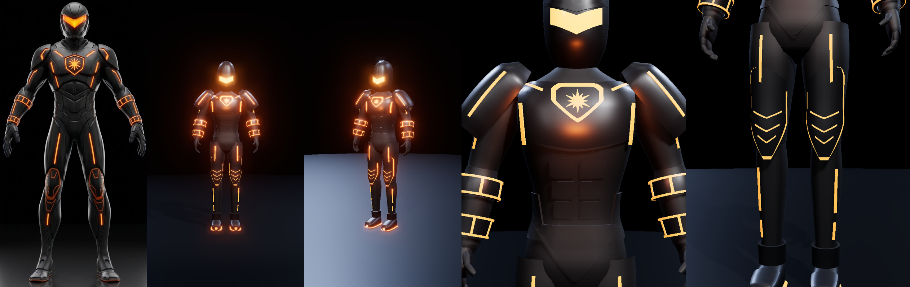

# Ember Suit — rigged 3D model

A game-ready, rigged rebuild of the armored suit in `reference/suit.jpg`. The black body
suit has glowing orange strips, a sun-and-shield chest emblem and a chevron visor.



## Files
| Path | What it is |
|---|---|
| `models/suit.glb` | **The deliverable.** Skinned mesh, 22-bone humanoid skeleton, 3 animation clips, 4 materials. |
| `web/index.html` + `web/suit.glb.txt` | Phone-friendly three.js viewer (bloom, power-up glow ripple, skeleton toggle). |
| `src/suit.js` | The procedural builder: skeleton, body surfaces, armor and glow placement. |
| `src/anim.js` | Idle / Walk / PowerUp clips as pure timeline functions of time. |
| `tools/build.mjs` | Rebuilds `models/suit.glb` and `web/suit.glb.txt` from `src/` in headless Chromium. |
| `tools/shots.mjs` | Renders viewer screenshots (`node tools/shots.mjs front="view=front"`). |
| `reference/suit.jpg` | The source image. |

## Model
- **Size:** 1.85 m tall, Y up, faces +Z, feet on the ground plane. About 49k triangles.
- **Skeleton:** Mixamo-style names (`Hips`, `Spine`, `Spine1`, `Spine2`, `Neck`, `Head`,
  `Left/RightShoulder`, `…Arm`, `…ForeArm`, `…Hand`, `…UpLeg`, `…Leg`, `…Foot`, `…ToeBase`),
  bound in an A-pose. Standard humanoid animations retarget onto it (Unity Humanoid,
  Unreal IK Retargeter, Godot's SkeletonProfileHumanoid, Mixamo clips).
- **Skinning:** suit surfaces blend smoothly across the hips, spine, shoulders, elbows,
  wrists, knees and ankles. Armor pieces are rigid or split 50/50 across a joint (shoulder
  pads, knee pads, elbow and wrist caps). No finger bones; the glove is one rigid hand.
- **Materials:** `suit` (matte), `armor` (satin), `glow` and `visor` (emissive, exported with
  `KHR_materials_emissive_strength`). Use bloom in your engine to get the glow.
- **Clips:** `Idle` (4 s loop: breathing, weight shift, feet planted), `Walk` (1.1 s in-place
  loop), `PowerUp` (2.6 s one-shot: crouch and gather, fast release, overshoot, settle back to
  the idle pose so it blends out cleanly). Motion follows Disney's principles at about 50%.
- **Validation:** Khronos glTF Validator reports 0 errors.

## How it was made
The `image-to-3d-rebuild` skill normally starts from an AI scan (Meshy, Tripo or TRELLIS).
No scan service was reachable from this session, so the suit was built straight from the
picture. Landmarks (joint heights, widths, strip and emblem positions) were measured off
the front view at 1.326 mm per pixel. Every front-facing detail is given in those image
coordinates and projected onto the body surface, so it lines up with the reference by
construction. The side and back are not in the image and were designed to match.

## Rebuild
```bash
npm install          # three@0.160.0
node tools/build.mjs # writes models/suit.glb and web/suit.glb.txt
```
Change proportions in `src/suit.js` (named sections per body part) and motion in
`src/anim.js`, then rebuild.

## Known limits
- No UV texture maps: materials are flat colors.
- No finger or facial bones.
- The pauldrons are rigid plates, so extreme arm raises (above about 70°) will clip.
